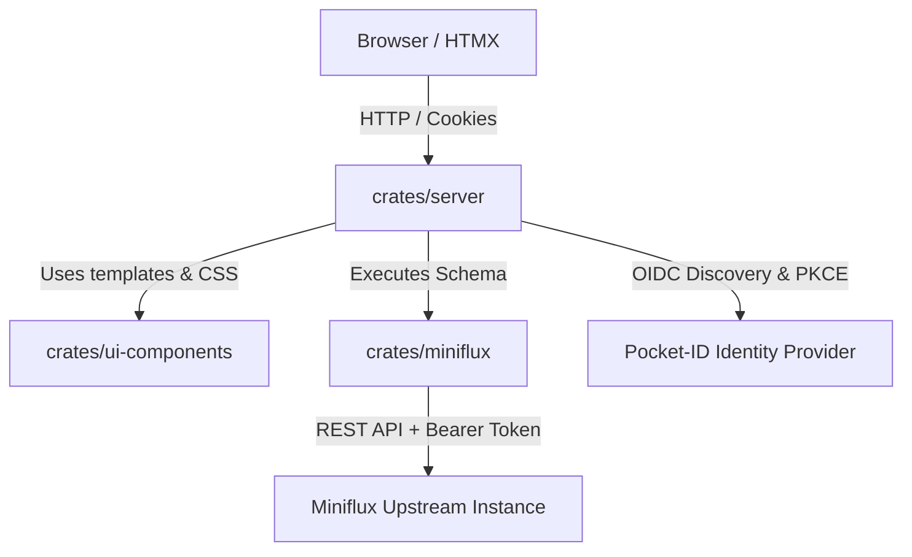
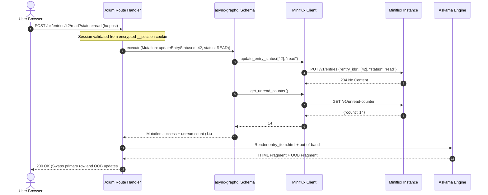

# Design — my-ui wrapper

**Result:** done

## Executive Summary

The **my-ui wrapper** is a lightweight, stateless web application written in Rust. It wraps a self-hosted Miniflux RSS instance with a spatial glassmorphism user interface inspired by augmented-reality design systems. The application enforces authentication through Pocket-ID via OpenID Connect (OIDC). Inside the server, an `async-graphql` schema abstracts upstream Miniflux REST operations, and Axum handlers render server-side Askama templates that respond directly to HTMX dynamic requests.

No dedicated database is required. All application state is stored upstream in Miniflux, and user authentication tokens are stored in encrypted, tamper-proof session cookies.

---

## Architectural Options & Decision

### Option A: In-Process GraphQL Execution for Template Handlers (Recommended)

In this approach, the Axum web routes execute GraphQL operations directly in-process through the compiled `async-graphql::Schema`. The template handlers call the schema resolvers without making any network requests or HTTP hops.

**Explanation:**  
The Rust server builds a single `async-graphql` schema. Axum template routes invoke `schema.execute(query)` or invoke resolver functions directly, passing the data into Askama compile-time templates. The `/graphql` HTTP endpoint is also exposed for external or programmatic access.

**Concrete Example:**
```rust
// In crates/server/src/routes/entries.rs
pub async fn list_entries_htmx(
    State(state): State<AppState>,
    user: AuthenticatedUser,
) -> Result<impl IntoResponse, AppError> {
    // Direct in-process query execution
    let request = async_graphql::Request::new(
        "{ entries(limit: 20) { id title summary publishedAt readingTime isBookmarked } }"
    );
    let res = state.schema.execute(request).await;
    let data: EntriesData = serde_json::from_value(res.data.into_json()?)?;
    
    // Render Askama template fragment
    let html = EntryListPartialTemplate { entries: data.entries }.render()?;
    Ok(Html(html))
}
```

**Pros:**
- **Zero network overhead**: No TCP handshakes or localhost loopback latency for internal UI rendering.
- **Single source of data contracts**: The GraphQL schema acts as the single contract for both internal HTMX templates and external API consumers.
- **Type safety**: Both the GraphQL resolvers and Askama templates are checked at compile time.

**Cons:**
- Slight JSON serialization overhead when converting GraphQL results to template view models (can be bypassed by calling resolver service functions directly when needed).

---

### Option B: Decoupled GraphQL HTTP Gateway with Loopback Fetch

In this approach, the web UI handlers treat the GraphQL endpoint as a completely separate HTTP service. The template handlers perform loopback HTTP requests (e.g., `http://127.0.0.1:3000/graphql`) using an HTTP client like `reqwest`.

**Explanation:**  
The server acts as two independent layers: an HTTP GraphQL API gateway and an HTMX template renderer. The renderer sends outbound HTTP POST requests with GraphQL queries to localhost.

**Concrete Example:**
```rust
pub async fn list_entries_htmx(
    State(client): State<reqwest::Client>,
    State(config): State<Config>,
) -> Result<impl IntoResponse, AppError> {
    let res = client
        .post(format!("{}/graphql", config.internal_url))
        .json(&serde_json::json!({
            "query": "{ entries(limit: 20) { id title summary } }"
        }))
        .send()
        .await?
        .json::<GraphQLResponse<EntriesData>>()
        .await?;
        
    let html = EntryListPartialTemplate { entries: res.data.entries }.render()?;
    Ok(Html(html))
}
```

**Pros:**
- Complete decoupling of frontend renderer and API layer.
- Frontend and backend could theoretically be split into different processes in the future.

**Cons:**
- **Unnecessary latency**: Every HTMX request suffers socket allocation, TCP overhead, and local HTTP parsing.
- **Port management**: Requires binding and managing internal ports and loopback addresses.
- **Extra failure modes**: Connection drops, connection pool exhaustion, and loopback timeouts.

---

### Recommendation & Justification

**Option A (In-Process Execution)** is selected.  
Because `my-ui` is explicitly designed as a single deployable binary with no database and minimal resource footprint, in-process execution gives maximum performance, zero loopback latency, and unified error handling while still preserving clean domain boundaries.

---

## System Architecture & Crate Layout

The project is structured as a Cargo workspace with three focused crates:



### 1. `crates/miniflux` (Upstream Domain, Extractive Summary & GraphQL Layer)
- **Miniflux REST Client**: An asynchronous `reqwest`-based client communicating with Miniflux v2.2.0 endpoints using API Key authentication.
  - Caches current user profile (`user_id: i64`) via `GET /v1/me` to support user-scoped endpoints like `PUT /v1/users/{userID}/mark-all-as-read`.
  - Executes concurrent calls (`tokio::join!`) to `GET /v1/feeds` and `GET /v1/feeds/counters` to merge unread counts directly into `Feed` domain models.
  - Performs batch status updates using `PUT /v1/entries` (`{"entry_ids": [id], "status": "read"}`).
- **Domain Models**: Strongly typed structs for Miniflux entities (`Entry`, `Feed`, `Category`, `Icon`, `User`).
- **Extractive Summarizer (`summary.rs`)**: Uses `unicode-segmentation` to extract the first 2 meaningful sentences from sanitized article content. Placing this in `crates/miniflux` allows the GraphQL `Entry` resolver to populate `summary: String!` directly without circular dependencies on `crates/ui-components`.
- **GraphQL Schema**: Built using `async-graphql`. Defines `Query` and `Mutation` root types, argument validators, and resolver functions.
- **Dependencies**: `async-graphql`, `reqwest`, `serde`, `serde_json`, `thiserror`, `unicode-segmentation`, `tokio`.

### 2. `crates/ui-components` (Design System & Templates)
- **Templates**: Askama compile-time templates for the spatial shell and HTMX fragments:
  - `pages/index.html`: Complete spatial shell with spatial header and navigation.
  - `partials/entry_list.html`: Feed entry list container.
  - `partials/entry_item.html`: Single entry row with hover glass effect and unread badge.
  - `partials/entry_detail.html`: Article reading modal / expanded view.
  - `partials/brief_card.html`: Extractive AI-style executive summary card.
  - `partials/toast.html`: Floating glass notification / error toast with out-of-band swap support.
  - `partials/error_card.html`: Glass error card with retry button.
- **Static Assets**: Embedded CSS styling from `ar-list.html` and `ar-detail.html`.
- **Content Sanitization**:
  - `ammonia`: Strict HTML sanitization ensuring script tags and malicious attributes in RSS content are stripped safely before rendering.
- **Dependencies**: `askama`, `ammonia`.

### 3. `crates/server` (Application Orchestrator & Gateway)
- **Axum Router**: Routes for full page loads, HTMX partials, auth endpoints, and `/graphql`.
- **Authentication**: Pocket-ID OIDC client using `openidconnect`, PKCE challenge generation, authorization code exchange, and token refresh.
- **Session Layer**: Cookie-based session management using `tower-cookies` with private (AES-256-GCM encrypted) cookie jars.
  - Ephemeral `__oidc_temp` cookie for stateless PKCE verifier and CSRF state storage.
  - Compact `__session` cookie strictly budgeted under 4KB for user tokens.
- **Configuration**: Strongly typed application configuration loaded from environment variables (`.env.example` reference).
- **Dependencies**: `axum`, `tokio`, `tower`, `tower-cookies`, `openidconnect`, `miniflux`, `ui-components`, `tracing`, `tracing-subscriber`.

---

## Data Flow & Sequence

### 1. Pocket-ID Authentication Flow (Stateless PKCE & CSRF Storage)

```mermaid
sequenceDiagram
    autonumber
    actor User as User Browser
    participant App as my-ui (Server)
    participant OIDC as Pocket-ID
    
    User->>App: GET /
    Note over App: Auth middleware checks __session cookie
    App-->>User: 302 Redirect to /auth/login
    User->>App: GET /auth/login
    App->>App: Generate PKCE verifier + CSRF state
    Note over App: Encrypt { pkce_verifier, csrf_state } into __oidc_temp cookie
    App-->>User: Set-Cookie: __oidc_temp=...; Max-Age=300; Path=/auth/callback; HttpOnly; SameSite=Lax<br/>302 Redirect to Pocket-ID /authorize
    User->>OIDC: Authenticate & Authorize
    OIDC-->>User: 302 Redirect to /auth/callback?code=...&state=...
    User->>App: GET /auth/callback?code=...&state=... (sends __oidc_temp cookie)
    App->>App: Decrypt __oidc_temp & verify state == csrf_state
    App->>OIDC: POST /token (exchange code + extracted pkce_verifier)
    OIDC-->>App: Tokens (id_token, access_token, refresh_token)
    App->>App: Extract sub/username; build compact SessionData (discard raw id_token)
    Note over App: Clear __oidc_temp cookie; encrypt SessionData into __session
    App-->>User: Set-Cookie: __oidc_temp=; Max-Age=0; Path=/auth/callback<br/>Set-Cookie: __session=...; Path=/; HttpOnly; SameSite=Lax<br/>302 Redirect to /
```

### 2. HTMX Content Loading & Mutation Flow (Out-of-Band Counter Updates)



---

## GraphQL Schema Definition

The schema provides unified querying and mutation for RSS items, categories, and feeds:

```graphql
enum EntryStatus {
  READ
  UNREAD
  REMOVED
}

enum OrderDirection {
  ASC
  DESC
}

type Feed {
  id: ID!
  title: String!
  siteUrl: String!
  feedUrl: String!
  checkedAt: String!
  category: Category!
  unreadCount: Int!
}

type Category {
  id: ID!
  title: String!
}

type Entry {
  id: ID!
  feedId: ID!
  title: String!
  url: String!
  author: String
  content: String!
  summary: String!
  publishedAt: String!
  status: EntryStatus!
  isBookmarked: Boolean!
  readingTime: Int!
  feed: Feed
}

input EntryFilter {
  status: EntryStatus
  feedId: ID
  categoryId: ID
  starred: Boolean
  search: String
  limit: Int
  offset: Int
  order: String
  direction: OrderDirection
}

type Query {
  entries(filter: EntryFilter): [Entry!]!
  entry(id: ID!): Entry
  feeds: [Feed!]!
  categories: [Category!]!
  unreadCounter: Int!
}

type Mutation {
  toggleBookmark(id: ID!): Boolean!
  updateEntryStatus(id: ID!, status: EntryStatus!): Boolean!
  markFeedAsRead(feedId: ID!): Boolean!
  markAllAsRead: Boolean!
}
```

### Resolver Specifications & Miniflux Mappings

1. **`Query.feeds`**:
   - Upstream `GET /v1/feeds` does not return unread counts.
   - The resolver calls `GET /v1/feeds` and `GET /v1/feeds/counters` concurrently via `tokio::join!`.
   - It matches `counters.unreads[feed.id]` to populate each `Feed.unreadCount` before returning.
2. **`Mutation.markAllAsRead`**:
   - Miniflux requires user-scoped marking: `PUT /v1/users/{userID}/mark-all-as-read`.
   - `MinifluxClient` caches the current user profile from `GET /v1/me` (retrieved during client initialization or lazily on first access).
   - The resolver calls `PUT /v1/users/{cached_user_id}/mark-all-as-read`.
3. **`Mutation.updateEntryStatus`**:
   - Invokes Miniflux batch update endpoint: `PUT /v1/entries` with body `{"entry_ids": [id], "status": "read" | "unread"}`.
4. **`Entry.summary`**:
   - Synthesized using `crates/miniflux/src/summary.rs` (`extract_summary(&entry.content, 2)`).
   - Computed during field resolution or entity mapping, guaranteeing a fast, non-null summary without external HTTP calls.

---

## HTMX Routing & Interaction Contracts

All interactive UI updates use HTMX attributes (`hx-get`, `hx-post`, `hx-target`, `hx-swap`).

### Endpoint Routing Table

| Method | Path | Purpose | Request Headers / Target | Response Type |
|---|---|---|---|---|
| **GET** | `/` | Main application shell | Standard browser request | Full HTML (`index.html`) |
| **GET** | `/auth/login` | Initiate OIDC authentication | Standard browser request | Sets `__oidc_temp`, 302 to Pocket-ID |
| **GET** | `/auth/callback` | OIDC redirect handler | Callback parameters | Clears `__oidc_temp`, sets `__session`, 302 to `/` |
| **GET** | `/auth/logout` | Clear session and log out | Standard browser request | Clears `__session`, 302 to `/auth/login` |
| **GET** | `/hx/entries` | Filtered list of entries | `hx-target="#entries-list"` | HTML Partial (`entry_list.html`) |
| **GET** | `/hx/entries/{id}` | Article detail view | `hx-target="#detail-panel"` | HTML Partial (`entry_detail.html`) |
| **POST** | `/hx/entries/{id}/bookmark` | Toggle article bookmark | `hx-target="this"` `hx-swap="outerHTML"` | HTML Partial (updated bookmark icon button) |
| **POST** | `/hx/entries/{id}/read` | Mark read / unread | `hx-target="closest .ar-list-item"` | HTML Partial (`entry_item.html`) + OOB `#unread-pill` |
| **POST** | `/hx/feeds/{id}/mark-all-read` | Mark entire feed read | `hx-target="#entries-list"` | HTML Partial (`entry_list.html`) + OOB `#unread-pill` |
| **POST** | `/graphql` | Standard GraphQL API | `Content-Type: application/json` | JSON response |

### Spatial Counter Synchronization Protocol (`#unread-pill`)

When a user mutates entry or feed status, the spatial header counter (`#unread-pill`) must stay in sync without triggering full page reloads:
- **Primary Swap**: The mutation updates the target DOM node (e.g., swapping the updated `.ar-list-item`).
- **Out-of-Band (OOB) Swap**: Every status-changing response includes an out-of-band `#unread-pill` element:
  ```html
  <!-- Primary fragment swapped into hx-target -->
  <div class="ar-list-item ...">...</div>

  <!-- Out-of-band counter update automatically swapped by HTMX -->
  <span id="unread-pill" hx-swap-oob="true" class="px-2.5 py-0.5 rounded-full bg-indigo-500/20 text-indigo-300 font-semibold text-[11px]">
    {{ unread_count }} unread
  </span>
  ```
- **Optional Client Event**: Responses may additionally set `HX-Trigger: {"updateUnreadCount": <unread_count>}` for custom JavaScript listeners.

### Request Parameter Contracts

- **`GET /hx/entries`**:
  ```rust
  #[derive(Deserialize)]
  pub struct EntriesFilterQuery {
      pub status: Option<String>,      // "all" | "unread" | "starred" (default: "unread")
      pub feed_id: Option<i64>,        // Filter by specific feed ID
      pub category_id: Option<i64>,    // Filter by category ID
      pub search: Option<String>,      // Search query string
      pub limit: Option<i64>,          // Default: 50, Max: 100
      pub offset: Option<i64>,         // Default: 0
  }
  ```
- **`POST /hx/entries/{id}/read`**:
  - Query/form parameter: `status=read` or `status=unread`.
  - If `status` is omitted, the handler toggles the entry between read and unread.

### Error Protocol for HTMX Requests

If an upstream Miniflux error, timeout, or validation failure occurs during an HTMX request (`HX-Request: true`):
1. **Prevent DOM Target Destruction**: The server does **not** return raw error text that would overwrite target buttons or rows.
2. **Error Toast Response**:
   - The server responds with HTTP 200, `HX-Reswap: none`, and an out-of-band toast container append:
     ```html
     <div id="toast-container" hx-swap-oob="beforeend">
       <div class="glass-toast error">
         <span>Failed to update entry: Upstream service unavailable</span>
       </div>
     </div>
     ```
   - Alternatively, it returns `HX-Reswap: none` with the header `HX-Trigger: {"showToast": {"message": "Upstream error", "level": "error"}}`.

---

## Template Architecture & Design System

### Visual Language: AR Spatial Glassmorphism
The visual interface directly implements the tokens defined in `ar-list.html` and `ar-detail.html`:
- **Dark Glass Backdrop**: `rgba(15, 23, 42, 0.72)` with `backdrop-filter: blur(32px) saturate(190%)`.
- **Gaze-Friendly Interactive Rows**: Subtle translucent rows (`rgba(255, 255, 255, 0.04)`) with indigo accent highlights on hover (`rgba(99, 102, 241, 0.16)`).
- **Responsive Layout via Modern CSS**:
  - The UI uses **container queries** (`@container (min-width: 720px)`) rather than hardcoded viewport breakpoints.
  - Grid structures leverage `repeat(auto-fit, minmax(280px, 1fr))` to naturally adjust to varied window dimensions.

### Article Summarization & Content Sanitization
- **AI Executive Brief Card**: The detail panel includes an executive summary card. The text is generated through the extractive 2-sentence summarizer in `crates/miniflux/src/summary.rs` (`unicode-segmentation`), allowing the card layout to function immediately while deferring external LLM API calls to v2.
- **HTML Sanitization**: Miniflux feeds deliver raw HTML in the `content` field. All content is processed with `ammonia` in `crates/ui-components/src/sanitizer.rs` using a strict whitelist:
  - Allowed tags: `p`, `b`, `i`, `strong`, `em`, `a`, `ul`, `ol`, `li`, `blockquote`, `pre`, `code`, `img`, `h1`-`h4`.
  - Enforced attributes: Links automatically receive `rel="noopener noreferrer"` and `target="_blank"`.

---

## Security Architecture & Session Management

### 1. Pocket-ID OIDC Integration & Stateless PKCE
- **OIDC Discovery**: The server initializes an `OpenIdClient` via Pocket-ID's OpenID Connect discovery document (`/.well-known/openid-configuration`).
- **PKCE Storage (`__oidc_temp`)**:
  - Authorization requests enforce **PKCE (Proof Key for Code Exchange)** with SHA-256 challenges.
  - To remain completely stateless without server memory or database, the transient `pkce_verifier` and `csrf_state` are stored in an encrypted cookie:
    - **Cookie Name**: `__oidc_temp`.
    - **Cipher**: AES-256-GCM via private cookie jar.
    - **Attributes**: `HttpOnly = true`, `Secure = true` (in production), `SameSite = Lax`, `Path = /auth/callback`, `Max-Age = 300` (5 minutes).
    - **Payload**: `{"pkce_verifier": "...", "csrf_state": "..."}`.
  - During `GET /auth/callback`:
    1. Read and decrypt `__oidc_temp`.
    2. Validate query `state` matches `csrf_state`.
    3. Use `pkce_verifier` in code exchange with Pocket-ID `/token`.
    4. Expire `__oidc_temp` immediately (`Max-Age = 0`).

### 2. Encrypted Session Cookie Budget (`__session`)
- **Cipher**: AES-256-GCM via `tower-cookies` private jar.
- **Key**: 64-byte secret key loaded from `SESSION_SECRET` in environment variables.
- **Attributes**: `HttpOnly = true`, `Secure = true` (in production), `SameSite = Lax`, `Path = /`.
- **Payload Strict Budget**: To avoid exceeding the 4,096-byte browser cookie limit, raw `id_token` and bulky JWT claims are discarded upon callback after extracting `sub` and `preferred_username`. The session payload is strictly constrained to:
  ```rust
  #[derive(Serialize, Deserialize)]
  pub struct SessionData {
      pub user_id: String,
      pub username: String,
      pub access_token: String,
      pub refresh_token: Option<String>,
      pub expires_at: i64,
  }
  ```
- **Logout Behavior**: `GET /auth/logout` clears `__session` and redirects to `/auth/login` (local session termination).

### 3. Miniflux Secret Isolation
- The Miniflux instance URL and API token (`MINIFLUX_BASE_URL` and `MINIFLUX_API_KEY`) reside exclusively in server memory.
- Upstream credentials are never exposed to browser clients, templates, or GraphQL payloads.

---

## Error Handling & Resilience

1. **Upstream Miniflux Outages**:
   - Timeouts on Miniflux REST calls are capped at 5 seconds.
   - If Miniflux is unreachable during page loads, the template route renders an AR-styled error notice (`error_card.html`) with an interactive `hx-get` retry button.
   - If Miniflux fails during an HTMX mutation, the server returns an out-of-band error toast without corrupting the triggering UI component.
2. **Expired OIDC Tokens**:
   - The auth middleware checks token expiration timestamps on every request.
   - If expired, the server attempts a silent refresh using `refresh_token`.
   - If refresh fails, the request returns an `HX-Redirect: /auth/login` response header, causing HTMX to redirect the browser cleanly to login.
3. **Invalid Request / Parsing Failures**:
   - Returns structured HTTP status codes with user-facing glass toast notifications.

---

## Configuration Reference (`.env.example`)

```bash
# Server configuration
PORT=3000
HOST=0.0.0.0
APP_BASE_URL=http://localhost:3000

# Session encryption secret (min 64 chars)
SESSION_SECRET=your-random-32-or-64-byte-base64-secret-key-goes-here

# Pocket-ID OIDC Configuration
OIDC_ISSUER_URL=https://id.example.com
OIDC_CLIENT_ID=my-ui-client
OIDC_CLIENT_SECRET=my-ui-client-secret
OIDC_REDIRECT_URL=http://localhost:3000/auth/callback

# Upstream Miniflux Configuration
MINIFLUX_BASE_URL=https://miniflux.example.com
MINIFLUX_API_KEY=your-miniflux-api-key-here
```

---

## Verifiable Reference Sources

- **Pocket-ID Endpoints & Documentation**: https://pocket-id.org/docs/api/endpoints
- **Miniflux REST API Specification**: [miniflux-openapi.yaml](file:///Users/ptquang86/ws/my-ui/miniflux-openapi.yaml)
- **RFC 7636 - Proof Key for Code Exchange (PKCE)**: https://datatracker.ietf.org/doc/html/rfc7636
- **AR Reference Templates**: [ar-list.html](file:///Users/ptquang86/ws/my-ui/ar-list.html) and [ar-detail.html](file:///Users/ptquang86/ws/my-ui/ar-detail.html)
- **Axum Web Framework**: https://docs.rs/axum/latest/axum/
- **Async-GraphQL**: https://async-graphql.github.io/async-graphql/en/index.html
- **Askama Compile-Time Templates**: https://docs.rs/askama/latest/askama/
- **Ammonia HTML Sanitizer**: https://docs.rs/ammonia/latest/ammonia/