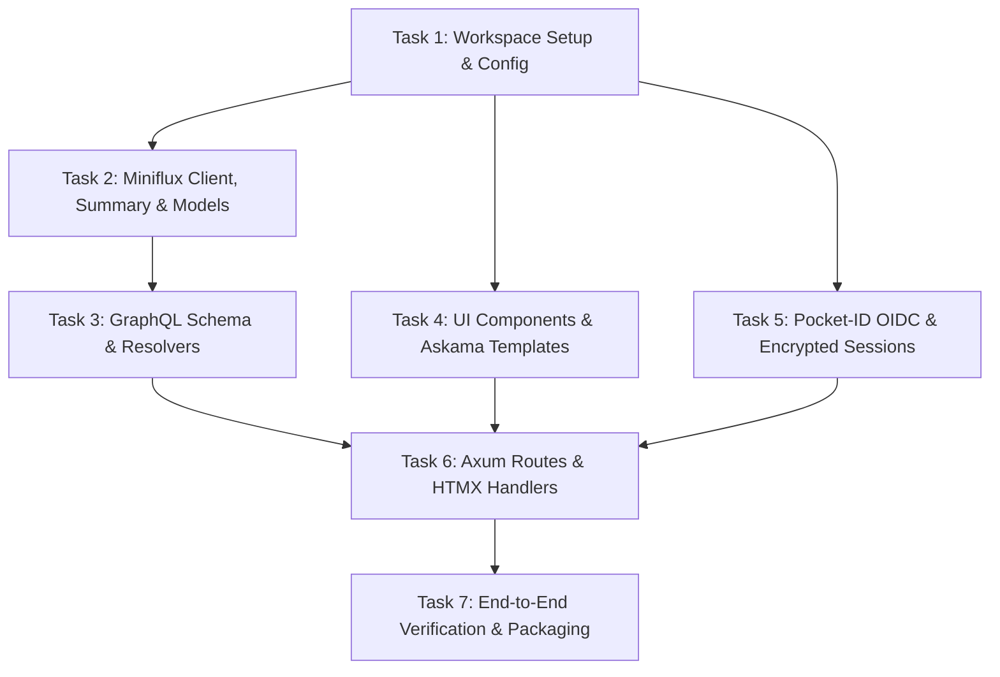

# Tasks — my-ui wrapper

**Result:** done

## Task Breakdown & Implementation Sequence

This plan follows strict Test-Driven Development (TDD). In each task, tests are written and verified to fail before implementation code is added.

---

### Task 1: Cargo Workspace Setup & Configuration

Set up the Cargo workspace with three member crates and define strongly typed configuration loading from environment variables.

- **Crates**:
  - `crates/server`
  - `crates/miniflux`
  - `crates/ui-components`
- **Deliverables**:
  - Root `Cargo.toml` with workspace members and shared dependency specifications.
  - `.env.example` documenting all configuration keys (`PORT`, `HOST`, `SESSION_SECRET`, `OIDC_*`, `MINIFLUX_*`).
  - `crates/server/src/config.rs` for parsing and validating environment variables.
- **TDD Tests**:
  - **Unit Test**: `test_config_loads_from_valid_env` — verifies correct parsing of server, OIDC, and Miniflux credentials.
  - **Unit Test**: `test_config_fails_when_secret_too_short` — ensures `SESSION_SECRET` with fewer than 32 bytes returns a validation error.
  - **Unit Test**: `test_config_defaults` — checks fallback defaults for host (`0.0.0.0`) and port (`3000`).

---

### Task 2: Miniflux REST Client, Extractive Summarizer & Domain Models

Implement the asynchronous client communicating with Miniflux v2.2.0 via `reqwest`, entity models, and the extractive text summarizer.

- **Deliverables**:
  - `crates/miniflux/src/models.rs`: Strongly typed structs for `Entry`, `Feed`, `Category`, `Icon`, and filter parameters.
  - `crates/miniflux/src/summary.rs`: Extractive 2-sentence text summarizer powered by `unicode-segmentation` for RSS content summaries.
  - `crates/miniflux/src/client.rs`: `MinifluxClient` struct with methods:
    - `get_me`: Retrieves and caches the current user's profile (`user_id: i64`) via `GET /v1/me`.
    - `get_entries`: Queries `/v1/entries` with pagination, ordering, and status filters.
    - `get_feeds`: Concurrently queries `GET /v1/feeds` and `GET /v1/feeds/counters` via `tokio::join!`, merging unread counters into `Feed` models.
    - `update_entry_status`: Sends batch status updates using `PUT /v1/entries` (`{"entry_ids": [id], "status": "read" | "unread"}`).
    - `mark_all_as_read`: Executes `PUT /v1/users/{cached_user_id}/mark-all-as-read`.
    - `toggle_bookmark`: Calls `PUT /v1/entries/{id}/bookmark`.
- **TDD Tests**:
  - **Unit Test (WireMock)**: `test_get_me_caches_user_id` — verifies `GET /v1/me` populates cached `user_id`.
  - **Unit Test (WireMock)**: `test_mark_all_as_read_uses_cached_user_id` — asserts `mark_all_as_read` dispatches to `PUT /v1/users/{user_id}/mark-all-as-read`.
  - **Unit Test (WireMock)**: `test_get_feeds_merges_unread_counters` — verifies `GET /v1/feeds` and `GET /v1/feeds/counters` are joined into `Feed.unread_count`.
  - **Unit Test (WireMock)**: `test_get_entries_success` — mocks Miniflux `/v1/entries` JSON response and asserts strongly typed deserialization.
  - **Unit Test (WireMock)**: `test_update_entry_status_sends_batch_payload` — validates `PUT /v1/entries` sends `{"entry_ids": [1], "status": "read"}`.
  - **Unit Test (WireMock)**: `test_toggle_bookmark_mutation` — mocks PUT `/v1/entries/{id}/bookmark` and verifies headers.
  - **Unit Test**: `test_extractive_summary_returns_first_two_sentences` — tests sentence boundary extraction and punctuation handling.
  - **Unit Test**: `test_miniflux_timeout_handling` — verifies client returns a structured `MinifluxError::Timeout` after 5 seconds.

---

### Task 3: GraphQL Schema & Resolvers (`async-graphql`)

Create the GraphQL schema wrapping the `MinifluxClient` using `async-graphql`.

- **Deliverables**:
  - `crates/miniflux/src/schema/types.rs`: GraphQL object representations of `Entry`, `Feed`, `Category`, and enums for `EntryStatus`.
  - `crates/miniflux/src/schema/query.rs`: Root `Query` resolving `entries`, `entry(id)`, `feeds` (with unread counts), `categories`, and `unreadCounter`.
  - `crates/miniflux/src/schema/mutation.rs`: Root `Mutation` resolving `toggleBookmark`, `updateEntryStatus`, `markFeedAsRead`, and `markAllAsRead`.
  - `crates/miniflux/src/schema/mod.rs`: `build_schema` constructor binding `MinifluxClient` into context.
- **TDD Tests**:
  - **Integration Test**: `test_graphql_query_entries` — executes in-memory query against schema with mocked client and verifies response JSON structure.
  - **Integration Test**: `test_graphql_query_feeds_includes_unread_count` — checks `Feed.unreadCount` resolves correctly from merged counters.
  - **Integration Test**: `test_graphql_entry_summary_resolved` — validates `Entry.summary` returns extracted 2-sentence summary.
  - **Integration Test**: `test_graphql_mutation_mark_all_as_read` — executes mutation and verifies invocation of user-scoped client method.
  - **Integration Test**: `test_graphql_invalid_filter_arguments` — confirms schema returns validation errors on negative limit or invalid offset.

---

### Task 4: Spatial Glass UI Components & Askama Templates

Construct Askama compile-time templates, CSS stylesheets, HTML sanitization, and out-of-band notification partials.

- **Deliverables**:
  - `crates/ui-components/src/sanitizer.rs`: HTML sanitizer function wrapping `ammonia` to strip script tags and sanitize attributes.
  - `crates/ui-components/templates/base.html`: Main HTML head, scripts (HTMX, Tailwind, Lucide icons), and spatial container.
  - `crates/ui-components/templates/pages/index.html`: Spatial layout shell with navigation sidebar and `#unread-pill`.
  - `crates/ui-components/templates/partials/entry_list.html`: Scrollable container of entry cards.
  - `crates/ui-components/templates/partials/entry_item.html`: Single row item with glass background, hover effects, and unread indicator.
  - `crates/ui-components/templates/partials/entry_detail.html`: Article reading panel with executive summary card.
  - `crates/ui-components/templates/partials/brief_card.html`: AI Executive Brief card partial.
  - `crates/ui-components/templates/partials/toast.html`: Out-of-band floating glass toast notification container.
  - `crates/ui-components/templates/partials/error_card.html`: Glass error card with retry action.
- **TDD Tests**:
  - **Unit Test**: `test_sanitizer_removes_dangerous_tags` — asserts `<script>`, `<iframe>`, and `onerror` attributes are stripped from feed HTML content.
  - **Unit Test**: `test_sanitizer_adds_noopener_to_links` — confirms outbound links contain `rel="noopener noreferrer"` and `target="_blank"`.
  - **Unit Test**: `test_render_entry_item_template` — checks rendered HTML string contains expected entry title, tags, and HTMX attributes.
  - **Unit Test**: `test_render_toast_oob_template` — verifies `toast.html` contains `hx-swap-oob="beforeend"` attribute.

---

### Task 5: Pocket-ID OIDC Authentication & Stateless Encrypted Sessions

Implement OIDC authentication with ephemeral encrypted PKCE/CSRF cookie storage and compact session management.

- **Deliverables**:
  - `crates/server/src/auth/oidc.rs`: Client initialization using `openidconnect` with discovery and PKCE challenge generation.
  - `crates/server/src/auth/temp_cookie.rs`: Ephemeral `__oidc_temp` cookie manager (`Max-Age = 300`, `Path = /auth/callback`, `HttpOnly`, `SameSite = Lax`) encrypting `{ pkce_verifier, csrf_state }`.
  - `crates/server/src/auth/session.rs`: Compact `SessionData` struct (user_id, username, access_token, refresh_token, expires_at) strictly budgeted under 4KB, serialized/deserialized with `tower-cookies` private jar.
  - `crates/server/src/auth/handlers.rs`: Handlers for `/auth/login` (sets `__oidc_temp`), `/auth/callback` (validates state, consumes PKCE verifier, clears `__oidc_temp`, sets `__session`), and `/auth/logout` (clears `__session`).
  - `crates/server/src/auth/middleware.rs`: Axum extractor/middleware enforcing valid authentication and initiating token refresh.
- **TDD Tests**:
  - **Unit Test**: `test_oidc_temp_cookie_encryption_and_roundtrip` — verifies PKCE verifier and CSRF state are safely stored and extracted from `__oidc_temp`.
  - **Unit Test**: `test_session_data_size_under_cookie_limit` — validates serialized encrypted `SessionData` is well within the 4KB limit.
  - **Integration Test**: `test_unauthenticated_request_redirects_to_login` — asserts protected routes return 302 redirect to `/auth/login` when no session exists.
  - **Integration Test**: `test_htmx_unauthenticated_request_returns_hx_redirect` — checks that HTMX requests receive `HX-Redirect` header when session is invalid.
  - **Integration Test**: `test_oidc_callback_state_mismatch_fails` — verifies CSRF protection rejects mismatched state parameters.
  - **Integration Test**: `test_oidc_callback_clears_temp_cookie` — ensures `__oidc_temp` has `Max-Age = 0` on callback completion.

---

### Task 6: Axum Web Routes & HTMX Handlers with OOB Synchronization

Connect all components into the Axum web server, expose HTMX partial endpoints, and implement out-of-band counter updates and error retargeting.

- **Deliverables**:
  - `crates/server/src/routes/pages.rs`: Handlers for root page (`/`) serving `index.html`.
  - `crates/server/src/routes/entries.rs`:
    - `GET /hx/entries`: Implements `EntriesFilterQuery` deserialization.
    - `GET /hx/entries/{id}`: Article detail view.
    - `POST /hx/entries/{id}/bookmark`: Bookmark toggle.
    - `POST /hx/entries/{id}/read`: Accepts optional query/form `status=read|unread` (or toggles), returns updated `entry_item.html` plus out-of-band `#unread-pill` swap.
    - `POST /hx/feeds/{id}/mark-all-read`: Marks feed read, returns updated `entry_list.html` plus out-of-band `#unread-pill` swap.
  - `crates/server/src/routes/graphql.rs`: Handler for standard `/graphql` HTTP endpoint.
  - `crates/server/src/error.rs`: HTMX error handler responding with `HX-Reswap: none` and out-of-band toast notification on failure.
  - `crates/server/src/app.rs`: Router assembly with middleware stack and state injection.
- **TDD Tests**:
  - **Integration Test**: `test_get_root_page_serves_html_shell` — validates full HTML response with 200 OK.
  - **Integration Test**: `test_hx_entries_filter_query_params` — verifies `GET /hx/entries` parses status, feed_id, limit, and offset.
  - **Integration Test**: `test_hx_read_returns_oob_unread_pill` — asserts POST to `/hx/entries/{id}/read` returns primary row HTML and out-of-band `#unread-pill` fragment.
  - **Integration Test**: `test_hx_bookmark_returns_updated_icon` — asserts POST to `/hx/entries/{id}/bookmark` triggers GraphQL mutation and returns updated HTML partial.
  - **Integration Test**: `test_htmx_error_returns_oob_toast_without_reswapping_target` — simulates upstream error and verifies `HX-Reswap: none` and toast OOB fragment.

---

### Task 7: End-to-End Verification & Packaging

Finalize integration, verify static assets, and implement end-to-end smoke verification.

- **Deliverables**:
  - Embedded static asset handler in Axum for CSS and icons.
  - End-to-end smoke test suite executing the complete pipeline in memory.
  - Documentation and verification commands.
- **TDD Tests**:
  - **Integration Test**: `test_e2e_authenticated_session_flow` — tests login -> session set -> entry list fetch -> read status toggle with OOB counter update -> logout.
  - **Smoke Test**: `test_app_starts_and_responds_to_health_check` — verifies server boots cleanly with mock upstream and responds to ping.