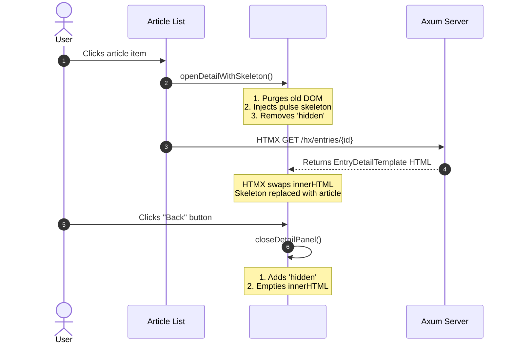

# Design: Fix Stale Content in Article Detail View

Result: done

---

## Key Takeaway

We replace inline DOM class toggling with two dedicated client helper functions: `openDetailWithSkeleton()` and `closeDetailPanel()`. When an article is clicked, old DOM content is immediately purged and replaced with a spatial glassmorphic skeleton with an interactive Back button while HTMX fetches the real content. When navigating back, the panel is hidden and emptied so stale data never persists.

---

## Architectural Data Flow



---

## Client Helper Architecture

The client helper functions will be defined in the `<script>` block of `crates/ui-components/templates/pages/index.html`.

### 1. `openDetailWithSkeleton()`
- **Purpose**: Reset panel state, inject skeleton placeholder, and display the panel instantly.
- **Implementation**:
  ```javascript
  function openDetailWithSkeleton() {
    const panel = document.getElementById('detail-panel');
    if (!panel) return;
    
    panel.innerHTML = `
      <div class="flex flex-col h-full animate-pulse select-none">
        <!-- Skeleton Header -->
        <div class="flex items-center justify-between pb-4 border-b border-white/10 mb-6 shrink-0">
          <button 
            type="button"
            onclick="closeDetailPanel()" 
            class="inline-flex items-center gap-1.5 px-3 py-1.5 rounded-full bg-white/5 hover:bg-white/10 text-xs font-medium text-slate-300 transition-colors pointer-events-auto">
            <svg class="w-4 h-4" fill="none" stroke="currentColor" viewBox="0 0 24 24">
              <path stroke-linecap="round" stroke-linejoin="round" stroke-width="2" d="M15 19l-7-7 7-7"/>
            </svg>
            <span>Back</span>
          </button>
          <div class="flex items-center gap-2">
            <div class="h-7 w-20 bg-white/10 rounded-full"></div>
            <div class="w-8 h-8 rounded-full bg-white/10"></div>
            <div class="w-8 h-8 rounded-full bg-white/10"></div>
          </div>
        </div>

        <!-- Skeleton Body -->
        <div class="flex-1 overflow-y-auto pr-2 space-y-4">
          <!-- Feed info & date -->
          <div class="flex items-center gap-2 mb-2">
            <div class="h-3.5 bg-indigo-400/30 rounded w-28"></div>
            <div class="h-3.5 bg-white/10 rounded w-16"></div>
          </div>

          <!-- Title placeholder -->
          <div class="space-y-2 mb-6">
            <div class="h-6 bg-white/20 rounded-lg w-4/5"></div>
            <div class="h-6 bg-white/15 rounded-lg w-2/3"></div>
          </div>

          <!-- AI Brief Card Skeleton -->
          <div class="rounded-2xl border border-white/10 bg-white/[0.03] p-4 space-y-2.5">
            <div class="flex items-center gap-2 mb-2">
              <div class="w-4 h-4 rounded bg-indigo-400/40"></div>
              <div class="h-3.5 bg-white/20 rounded w-24"></div>
            </div>
            <div class="h-3 bg-white/10 rounded w-full"></div>
            <div class="h-3 bg-white/10 rounded w-5/6"></div>
          </div>

          <!-- Prose Content Skeleton Lines -->
          <div class="space-y-3 pt-2">
            <div class="h-4 bg-white/10 rounded w-full"></div>
            <div class="h-4 bg-white/10 rounded w-11/12"></div>
            <div class="h-4 bg-white/10 rounded w-4/5"></div>
            <div class="h-4 bg-white/10 rounded w-full"></div>
            <div class="h-4 bg-white/10 rounded w-3/4"></div>
          </div>
        </div>
      </div>
    `;
    panel.classList.remove('hidden');
  }
  ```

### 2. `closeDetailPanel()`
- **Purpose**: Hide the detail view and clear its contents.
- **Implementation**:
  ```javascript
  function closeDetailPanel() {
    const panel = document.getElementById('detail-panel');
    if (!panel) return;
    panel.classList.add('hidden');
    panel.innerHTML = '';
  }
  ```

---

## Template Modifications

### 1. `crates/ui-components/templates/partials/entry_item.html`
- **Target**: Row container click handler on the item title container.
- **Change**:
  ```html
  <!-- Before -->
  <div class="flex items-center gap-2.5 flex-1 min-w-0" hx-get="/hx/entries/{{ entry.id }}" hx-target="#detail-panel" onclick="document.getElementById('detail-panel').classList.remove('hidden')">

  <!-- After -->
  <div class="flex items-center gap-2.5 flex-1 min-w-0" hx-get="/hx/entries/{{ entry.id }}" hx-target="#detail-panel" onclick="openDetailWithSkeleton()">
  ```

### 2. `crates/ui-components/templates/partials/entry_list.html`
- **Target**: List iteration item click handler.
- **Change**:
  ```html
  <!-- Before -->
  <div class="flex items-center gap-2.5 flex-1 min-w-0" hx-get="/hx/entries/{{ entry.id }}" hx-target="#detail-panel" onclick="document.getElementById('detail-panel').classList.remove('hidden')">

  <!-- After -->
  <div class="flex items-center gap-2.5 flex-1 min-w-0" hx-get="/hx/entries/{{ entry.id }}" hx-target="#detail-panel" onclick="openDetailWithSkeleton()">
  ```

### 3. `crates/ui-components/templates/partials/entry_detail.html`
- **Target**: Back button in the detail view header.
- **Change**:
  ```html
  <!-- Before -->
  <button 
    onclick="document.getElementById('detail-panel').classList.add('hidden')" 
    class="inline-flex items-center gap-1.5 px-3 py-1.5 rounded-full bg-white/5 hover:bg-white/10 text-xs font-medium text-slate-300 transition-colors">

  <!-- After -->
  <button 
    onclick="closeDetailPanel()" 
    class="inline-flex items-center gap-1.5 px-3 py-1.5 rounded-full bg-white/5 hover:bg-white/10 text-xs font-medium text-slate-300 transition-colors">
  ```

---

## Edge Case Analysis

1. **Slow Network / Network Failure**:
   The skeleton contains an interactive Back button (`pointer-events-auto`) that executes `closeDetailPanel()`. If the server request times out or takes several seconds, the user is not trapped and can dismiss the loading view immediately. If the request fails on the server, an out-of-band toast is rendered into `#toast-container` without breaking the panel.
2. **Rapid Item Switching**:
   If a user clicks Article 1, immediately dismisses, and clicks Article 2:
   `openDetailWithSkeleton()` unconditionally replaces `#detail-panel` contents with a fresh skeleton. When the HTMX swap for Article 2 completes, it overwrites the skeleton with Article 2's content. Stale Article 1 content is never shown.
3. **Esc Key / Modal Behavior**:
   Keyboard navigation and accessibility can optionally hook into `closeDetailPanel()` in future enhancements without changing the template contract.

---

## Verification & Test Plan

1. **Unit Tests in `crates/ui-components/src/templates.rs`**:
   - `test_entry_item_wires_open_detail_with_skeleton`: Verify `entry_item.html` calls `openDetailWithSkeleton()`.
   - `test_entry_list_wires_open_detail_with_skeleton`: Verify `entry_list.html` calls `openDetailWithSkeleton()`.
   - `test_entry_detail_wires_close_detail_panel`: Verify `entry_detail.html` calls `closeDetailPanel()`.
   - `test_index_template_defines_detail_panel_helpers`: Verify `pages/index.html` defines both JavaScript functions and contains the pulse skeleton structure.
2. **Build and Test Verification**:
   - Run `cargo test -p ui-components` to ensure 100% pass rate.
