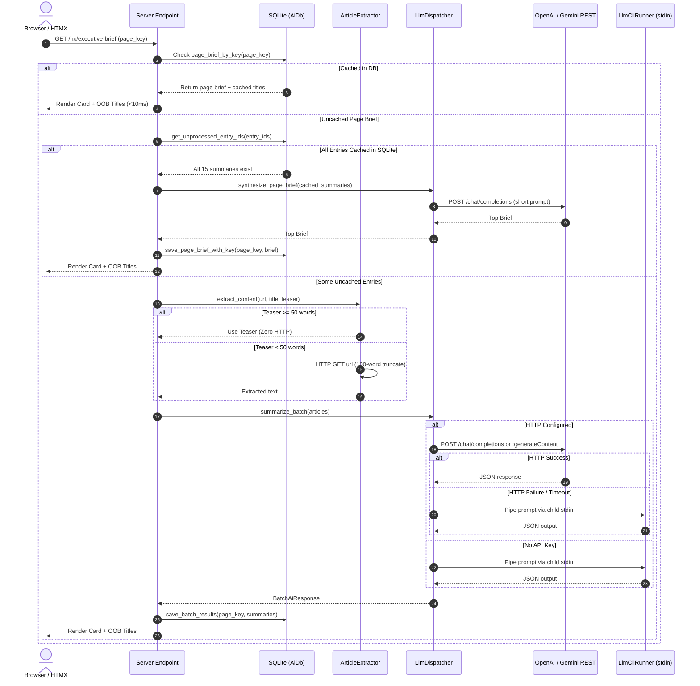

# System Design: AI Performance, Efficiency & Native REST Client

## 1. Executive Summary & Core Milestones

This design accelerates AI pipeline throughput, removes process spawning bottlenecks, eliminates redundant scraping and token usage, and guarantees 100% executive brief availability.

Key takeaways:
- **Fast-path scraper avoidance**: Bypasses external HTTP scraping whenever an RSS teaser contains $\ge 50$ words, cutting multi-second network latency and preventing scraper timeouts.
- **Drastic token reduction**: Lowers word truncation from 250 to 100 words per article and eliminates duplicate `Title: ...` headers, cutting prompt tokens by >60%.
- **Zero subprocess overhead**: Introduces native HTTP REST clients for OpenAI-compatible endpoints and Google Gemini REST API using keep-alive connection pooling via `reqwest`.
- **Bulletproof CLI fallback with stdin piping**: Automatically falls back to `LlmCliRunner` on network or HTTP errors, passing prompts through standard input (`stdin`) to bypass command-line length constraints.
- **Prefetch cache correctness & sensitivity**: Saves background prefetch page briefs with `page_key` into `page_executive_briefs_v2` and triggers on $\ge 1$ uncached item.
- **Guaranteed brief synthesis on cached pages**: When all page items are already cached in SQLite, synthesizes the top executive brief directly from cached item summaries instead of returning an empty placeholder.

---

## 2. Design Options & Trade-Offs

### Option 1: Unified Dynamic Backend with Resilient Fallback (Recommended)

- **Explanation**: A unified `LlmBackend` (or `LlmDispatcher`) wraps both `LlmHttpClient` and `LlmCliRunner`. When `LLM_API_KEY` is present, it routes requests directly to the native HTTP client (OpenAI or Gemini REST format). If the HTTP request fails due to network outage, timeout, rate limit (429), or 5xx server error, it logs a warning and immediately falls back to `LlmCliRunner` via `stdin`. If no `LLM_API_KEY` is configured, it directly dispatches to `LlmCliRunner`.
- **Concrete Example**:
  ```rust
  pub enum LlmBackend {
      Cli(LlmCliRunner),
      Http {
          client: LlmHttpClient,
          fallback: LlmCliRunner,
      },
  }

  impl LlmBackend {
      pub async fn summarize_batch(&self, articles: &[(i64, &str, &str)]) -> (BatchAiResponse, String) {
          match self {
              Self::Cli(cli) => cli.summarize_batch(articles).await,
              Self::Http { client, fallback } => {
                  match client.summarize_batch(articles).await {
                      Ok((res, model)) => (res, model),
                      Err(err) => {
                          tracing::warn!("HTTP LLM client failed: {}. Falling back to CLI", err);
                          fallback.summarize_batch(articles).await
                      }
                  }
              }
          }
      }
  }
  ```
- **Pros**:
  - Maximum performance in production (~300–800ms saved per batch by avoiding process spawning).
  - High availability: zero disruption if external API experiences transient outages or rate limits.
  - Zero breaking changes for existing CLI-based deployments.
- **Cons**:
  - Requires maintaining both HTTP payload schemas (OpenAI and Gemini) alongside CLI runner.

### Option 2: Strict Static Backend Selection (No Runtime Fallback)

- **Explanation**: The backend is strictly configured at startup as either HTTP or CLI. If the HTTP client fails during runtime, the request fails immediately without attempting CLI execution.
- **Concrete Example**:
  ```rust
  if config.use_http {
      client.execute().await?
  } else {
      cli.execute().await?
  }
  ```
- **Pros**: Slightly simpler code path with no dual-dispatch fallback logic.
- **Cons**: Fragile in environments with intermittent network issues; fails user requests immediately if API key limits are reached.

> **Recommendation**: **Option 1**. The resilient dynamic backend provides optimal performance while ensuring zero downtime.

---

## 3. Detailed Component Architecture

### 3.1 Content Extraction Optimization (`crates/server/src/ai/extractor.rs`)

1. **Teaser Word Count Fast-Path**:
   - Before executing `self.client.get(url).send().await`, extract clean text from the teaser using `miniflux_client::summary::extract_summary(teaser, 2)`.
   - If clean teaser text word count $\ge 50$, use the teaser immediately without initiating an HTTP GET.
2. **Word Truncation**:
   - Lower word truncation limit from 250 words down to 100 words in `parse_html` and fallbacks.
3. **Prompt Formatting Cleanliness**:
   - Avoid nesting duplicate `Title: ...` prefixes. `extractor.rs` returns raw extracted article content, and the batch prompt builder handles article labeling.

### 3.2 Native HTTP REST Client & Stdin CLI (`crates/server/src/ai/llm.rs`)

1. **`LlmHttpClient`**:
   - Built on `reqwest::Client` with 30-second timeout and connection pooling.
   - **OpenAI Endpoint**:
     - URL: `{base_url}/chat/completions` (default base: `https://api.openai.com/v1`).
     - Header: `Authorization: Bearer {api_key}`.
     - Payload:
       ```json
       {
         "model": "gpt-4o-mini",
         "messages": [{"role": "user", "content": "<batch_prompt>"}],
         "response_format": {"type": "json_object"}
       }
       ```
     - Response Extraction: `choices[0].message.content`.
   - **Gemini Endpoint**:
     - URL: `https://generativelanguage.googleapis.com/v1beta/models/{model}:generateContent?key={api_key}`.
     - Header: `Content-Type: application/json`.
     - Payload:
       ```json
       {
         "contents": [{"parts": [{"text": "<batch_prompt>"}]}],
         "generationConfig": {"responseMimeType": "application/json"}
       }
       ```
     - Response Extraction: `candidates[0].content.parts[0].text`.
   - **Response Parsing**: Uses `serde_json::from_str` with fallback to existing `TOP_REGEX` and `ITEM_REGEX`.
2. **`LlmCliRunner` Stdin Piping**:
   - Configures child process:
     ```rust
     let mut child = Command::new(&self.cli_cmd)
         .args(&self.build_args_without_prompt())
         .stdin(Stdio::piped())
         .stdout(Stdio::piped())
         .stderr(Stdio::piped())
         .spawn()?;
     if let Some(mut stdin) = child.stdin.take() {
         stdin.write_all(prompt.as_bytes()).await?;
     }
     ```
   - Eliminates `ARG_MAX` buffer limits.

### 3.3 Prefetch Sensitivity & Cache Key Fix (`crates/server/src/ai/prefetch.rs`)

1. **Threshold Adjustment**:
   - Change `const PREFETCH_THRESHOLD: usize = 1;` so prefetch runs for any fresh uncached entries.
2. **Keyed Page Brief Storage**:
   - In `run_prefetch`:
     ```rust
     if !batch_res.top.is_empty() {
         let _ = ai.db.save_page_brief_with_key(&batch_key, &batch_res.top).await;
     }
     ```

### 3.4 Cached Page Synthesis (`crates/server/src/routes/entries.rs`)

1. In `executive_brief_htmx`:
   - If `uncached_set.is_empty()` and `ai_service.db.get_page_brief_by_key(&page_key).await` is `None`:
     - Load cached summaries for visible entry IDs: `ai_service.db.get_batch_summaries(&entry_ids).await`.
     - Format a synthesis prompt using the cached article summaries:
       ```text
       Synthesize a 1-2 sentence executive brief (<35 words) from these article summaries:
       [ID 1] Title: ... Summary: ...
       ```
     - Dispatch to LLM to generate the page brief.
     - Save the generated brief with `page_key` into `page_executive_briefs_v2`.
     - Render the card and OOB title updates.

---

## 4. Sequence Diagram



---

## 5. Security & Configuration Review

- **Zero Secret Leakage**: `LLM_API_KEY` is marked sensitive and never logged, displayed in templates, or returned to clients.
- **Piped CLI Execution**: No shell expansion (`sh -c`) is used; arguments are explicitly passed and prompts are streamed via stdin.
- **Fail-Closed Caching**: In-flight concurrency mutex prevents duplicate parallel execution for identical page keys.

## Result

Result: done
