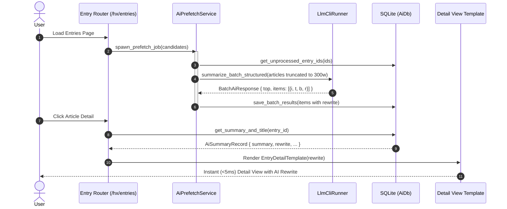

# Design: Details Page AI Rewrite with Batch Pre-request

- **Workflow Slug:** `20261123-details-ai-rewrite-batch-pre-request`
- **Mode:** full
- **Result:** done

---

## 1. Architectural Options & Recommendation

### Option 1 (Recommended): Unified Batch Pre-request with SQLite Caching

- **Explanation**: Generate the article detail **AI Rewrite** (`r`) in the exact same batch LLM request that produces executive titles (`t`), feed-card briefs (`b`), and the page overview (`top`). Background batch prefetching is triggered on page load for uncached entries. Rewrites are cached in SQLite (`article_ai_summaries`). When an article is opened in the web UI, the detail view reads the precomputed rewrite directly from local SQLite.
- **Concrete Example**:
  ```rust
  // Background prefetch in AiPrefetchService saves all fields in one transaction
  ai.db.save_batch_results(
      Some((&page_key, &batch_res.top)),
      &items_with_rewrite,
  ).await?;

  // Route handler serves detail view from SQLite in < 5ms
  let summary_record = ai_service.db.get_summary_and_title(id).await;
  let rewrite_content = summary_record
      .and_then(|r| r.rewrite)
      .unwrap_or_else(|| fallback_teaser);
  ```
- **Pros**:
  - **Zero detail page loading lag**: SQLite query resolves in `< 5ms`, delivering an instant 60fps detail transition without loading spinners.
  - **Token efficiency**: System prompt (~300 tokens) is amortized once across 20 entries (~15 tokens/article). Total tokens for 20 articles is ~5,500 tokens (vs. 11,000–22,000 for on-demand).
  - **Offline resilience**: Once pre-requested, rewrites are fully readable in SQLite without active network access.
  - **No duplicate roundtrips**: Titles, list briefs, and detail rewrites are completed in a single LLM invocation per page.
- **Cons**:
  - Batch output tokens increase by ~1,000 tokens per 20-item batch.

### Option 2: On-Demand Lazy Generation on Detail Click

- **Explanation**: Only generate titles and list briefs during batching. Defer generating the detail rewrite until the user explicitly clicks an article in the UI.
- **Concrete Example**:
  ```rust
  // On GET /hx/entries/{id}, trigger standalone LLM request if rewrite is missing
  if rewrite.is_none() {
      rewrite = Some(ai_service.llm.generate_single_rewrite(&content).await?);
  }
  ```
- **Pros**:
  - Batch payload remains slightly smaller for articles that are never clicked.
- **Cons**:
  - **Sluggish UX**: User experiences a 1.5s–4.5s blocking delay or loading spinner on every article opened.
  - **High token overhead**: Repeating system prompts across individual requests consumes 2&times; to 4&times; more total tokens.
  - **Fragility**: Upstream LLM timeouts directly break the interactive reading experience.

### Recommendation & Rationale

**Option 1 is strongly recommended**. It aligns directly with the settled Grill decisions (`02b-grill.md`), provides sub-5ms opening times, and minimizes token costs through batch prompt amortization.

---

## 2. Core Contracts & Specifications

### A. SQLite Schema Migration (`user_version = 4`)

- **Target File**: [crates/server/src/ai/db.rs](file:///Users/ptquang86/ws/my-ui/crates/server/src/ai/db.rs)
- **Migration Logic**:
  Check `PRAGMA user_version < 4`. Verify column existence via `PRAGMA table_info(article_ai_summaries)` before running `ALTER TABLE`:
  ```sql
  -- Migration to user_version = 4
  ALTER TABLE article_ai_summaries ADD COLUMN rewrite TEXT;
  PRAGMA user_version = 4;
  ```
- **Data Structures**:
  ```rust
  #[derive(Debug, Clone, PartialEq, Eq)]
  pub struct AiSummaryRecord {
      pub entry_id: i64,
      pub summary: String,
      pub suggested_title: Option<String>,
      pub rewrite: Option<String>,
      pub model: String,
      pub created_at: String,
  }

  #[derive(Debug, Clone, PartialEq, Eq)]
  pub struct ArticleSummaryInput {
      pub entry_id: i64,
      pub summary: String,
      pub suggested_title: Option<String>,
      pub rewrite: Option<String>,
      pub model: String,
  }
  ```
- **Upsert Semantics**:
  To protect against null overwrites when saving single updates or batches:
  ```sql
  INSERT INTO article_ai_summaries (entry_id, summary, suggested_title, rewrite, model, created_at)
  VALUES (?1, ?2, ?3, ?4, ?5, strftime('%Y-%m-%dT%H:%M:%SZ', 'now'))
  ON CONFLICT(entry_id) DO UPDATE SET
    summary = excluded.summary,
    suggested_title = COALESCE(excluded.suggested_title, article_ai_summaries.suggested_title),
    rewrite = COALESCE(excluded.rewrite, article_ai_summaries.rewrite),
    model = excluded.model,
    created_at = excluded.created_at;
  ```

---

### B. Batch LLM Prompt & Response Contract

- **Target File**: [crates/server/src/ai/llm.rs](file:///Users/ptquang86/ws/my-ui/crates/server/src/ai/llm.rs)
- **JSON Output Contract**:
  ```json
  {
    "top": "Page-level executive overview synthesizing major news...",
    "items": [
      {
        "i": 101,
        "t": "Short punchy title strictly in one sentence",
        "b": "Executive brief strictly in 3 sentences.",
        "r": "Conclusion and primary impact in first two sentences.\n\n• Supporting detail or key figure.\n• Implication or forward-looking context."
      }
    ]
  }
  ```
- **Rust Serde Types**:
  ```rust
  #[derive(Debug, Clone, PartialEq, Eq, Serialize, Deserialize, Default)]
  pub struct BatchAiItem {
      #[serde(rename = "i")]
      pub id: i64,
      #[serde(rename = "t")]
      pub suggested_title: String,
      #[serde(rename = "b")]
      pub brief: String,
      #[serde(default, rename = "r")]
      pub rewrite: Option<String>,
  }

  #[derive(Debug, Clone, PartialEq, Eq, Serialize, Deserialize, Default)]
  pub struct BatchAiResponse {
      #[serde(default)]
      pub top: String,
      #[serde(default)]
      pub items: Vec<BatchAiItem>,
  }
  ```
- **Fallback Regex Capture**:
  Support parsing responses if markdown backticks or minor JSON format anomalies occur:
  ```rust
  static ref ITEM_REGEX: Regex = Regex::new(
      r#"\{[^{}]*?"i"\s*:\s*(\d+)[^{}]*?"t"\s*:\s*"([^"\\]*(?:\\.[^"\\]*)*)"[^{}]*?"b"\s*:\s*"([^"\\]*(?:\\.[^"\\]*)*)"(?:[^{}]*?"r"\s*:\s*"([^"\\]*(?:\\.[^"\\]*)*)")?[^{}]*?\}"#
  ).expect("valid regex");
  ```

---

### C. Rewrite Formatting & Cognitive Rules

The LLM prompt instructions in `format_batch_prompt_structured` enforce:
1. **Length Cap & Sweet Spot**:
   - Strictly `< 110 words` total.
   - Target sweet spot: **30–60 words** in 2–3 bullet points or short paragraphs.
2. **Inverted Pyramid Model**:
   - The first 2 sentences **must** state the definitive outcome, conclusion, and significance.
   - Follow with 1–2 bullet points providing supporting evidence, data, or context.
3. **Multilingual Parity**:
   - Vietnamese source text &rarr; Vietnamese rewrite (`r`), title (`t`), and brief (`b`).
   - English source text &rarr; English rewrite (`r`), title (`t`), and brief (`b`).
   - Cross-translation is strictly prohibited.

---

### D. Input Content Truncation (300 Words Cap)

- **Target Location**: Input extraction pipeline in [crates/server/src/ai/llm.rs](file:///Users/ptquang86/ws/my-ui/crates/server/src/ai/llm.rs) or [crates/server/src/ai/prefetch.rs](file:///Users/ptquang86/ws/my-ui/crates/server/src/ai/prefetch.rs).
- **Rule**: Cap each entry's content at the first **300 words** (or fallback to teaser if $\ge 50$ words).
- **Algorithm**:
  ```rust
  pub fn truncate_words(text: &str, max_words: usize) -> &str {
      let mut word_count = 0;
      let mut end_index = text.len();
      for (idx, ch) in text.char_indices() {
          if ch.is_whitespace() {
              word_count += 1;
              if word_count >= max_words {
                  end_index = idx;
                  break;
              }
          }
      }
      &text[..end_index]
  }
  ```
- **Benefit**: Ensures the LLM receives adequate context for inverted pyramid generation while bounding the prompt size.

---

### E. Server-Side Pre-requesting Architecture

- **Target File**: [crates/server/src/ai/prefetch.rs](file:///Users/ptquang86/ws/my-ui/crates/server/src/ai/prefetch.rs)
- **Lifecycle Flow**:
  1. **Trigger**: When entries for a page are queried in `crates/server/src/routes/entries.rs`, `spawn_prefetch_job` is invoked asynchronously.
  2. **Filter**: Check `ai.db.get_unprocessed_entry_ids(&ids)` to skip already cached entries.
  3. **Concurrency Guard**: Lock `batch_key` in `ai.in_flight` to prevent duplicate parallel LLM calls.
  4. **Extraction**: Fetch and truncate article texts concurrently up to 20 items.
  5. **Batch Generation**: Call `summarize_batch_structured` to obtain `top`, `t`, `b`, and `r`.
  6. **Persistence**: Store all items into `article_ai_summaries` including `rewrite` via `save_batch_results`.

---

### F. Detail Page UI Templates & Rendering Contract

- **Target Files**:
  - [crates/ui-components/templates/partials/entry_detail.html](file:///Users/ptquang86/ws/my-ui/crates/ui-components/templates/partials/entry_detail.html)
  - [crates/ui-components/src/templates.rs](file:///Users/ptquang86/ws/my-ui/crates/ui-components/src/templates.rs)
  - [crates/server/src/routes/entries.rs](file:///Users/ptquang86/ws/my-ui/crates/server/src/routes/entries.rs)
- **Display Rules (Settled Option B & 1A)**:
  - **Primary Body Content**: Render `rewrite` as the main article content inside the prose container.
  - **Raw HTML Omission**: `sanitized_content` is **not** rendered in the details DOM, keeping the view clean, lightweight, and focused.
  - **Graceful Fallback (Option 1A)**: If `rewrite` is not yet available in SQLite or if LLM generation failed, render the 3-sentence executive brief (`summary`) or teaser so the user is never presented with an empty space.
  - **External Link Reference**: The top action bar contains the external "Original" link button directing to `entry.url` for the full original article.
- **Template Schema**:
  ```rust
  #[derive(Template)]
  #[template(path = "partials/entry_detail.html")]
  pub struct EntryDetailTemplate {
      pub entry: EntryViewModel,
      pub rewrite: String,
      pub is_rewrite: bool,
      pub auth_enabled: bool,
  }
  ```
- **Template Markup**:
  ```html
  <!-- Detail Body -->
  <div class="detail-scrollbar detail-body flex-1 overflow-y-auto pr-2 w-full max-w-[44rem] mx-auto">
    <div class="flex items-center gap-2 text-xs text-muted-foreground mb-2 font-sans tabular">
      <span class="font-medium text-foreground">{{ entry.feed_title }}</span>
      <span>•</span>
      <span>{{ entry.published_at }}</span>
    </div>

    <h1 class="text-2xl font-bold font-sans text-foreground mb-6 leading-snug">
      {{ entry.title }}
    </h1>

    <!-- AI Brief Card Partial (if applicable) -->
    
      
    

    <!-- Primary AI Rewrite Body -->
    <div class="prose dark:prose-invert max-w-none text-foreground/90 text-sm leading-relaxed space-y-4 font-sans whitespace-pre-line">
      {{ rewrite }}
    </div>
  </div>
  ```

---

## 3. Data Flow Diagram



---

## 4. Risks & Mitigations

1. **Prompt Length Expansion**:
   - *Risk*: Adding rewrites across 20 entries could cause output truncation if LLM `max_tokens` is too small.
   - *Mitigation*: Ensure batch prompt explicitly instructs `< 110 words, target 30–60 words` and `TIMEOUT_SECS` is maintained at 90s.
2. **Missing Rewrites on Cache Miss**:
   - *Risk*: User opens an article immediately before background prefetch finishes.
   - *Mitigation*: Fallback Option 1A seamlessly displays the executive brief or teaser without UI breakage.
3. **Database Concurrency**:
   - *Risk*: Background prefetch writing rewrites while detail view reads.
   - *Mitigation*: WAL mode (`PRAGMA journal_mode = WAL`) and `busy_timeout = 5000` allow concurrent readers while a write transaction executes.

---

## Result

Result: done
