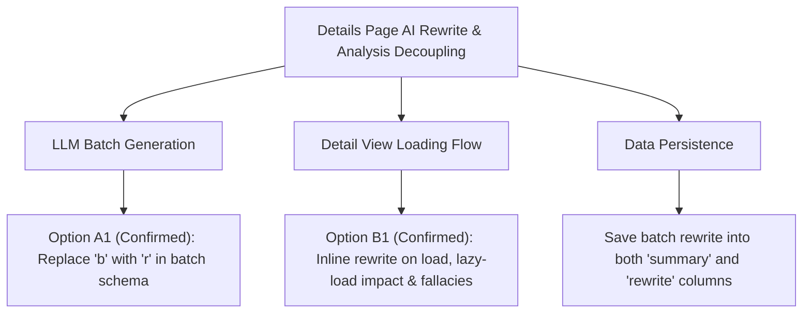

# Grill: Stress-Test Plan & Design Tree

## Design Tree & Settled Decisions

### Settled Decisions
1. **Batch Schema**: Confirmed Option A1. Drop 3-sentence brief `"b"` from batch output; generate suggested title `"t"` and inverted-pyramid rewrite `"r"`.
2. **Detail Page Render Flow**: Confirmed Option B1. Remove "Executive Brief" card partial (`brief_card.html`). Render `rewrite` text immediately on initial load.
3. **Impact & Fallacies Request**: Decoupled from rewrite. Render an HTMX placeholder with skeleton below the rewrite; trigger `hx-get="/hx/entries/{{ entry.id }}/analysis"` with `hx-trigger="load"` and `hx-swap="outerHTML"`.
4. **Database Storage**: Confirmed storing `item.rewrite` into both `summary` and `rewrite` columns in `article_ai_summaries`, maintaining database column constraints (`summary NOT NULL`) and keeping feed views synchronized with high quality rewrites.
5. **Multilingual Consistency**: Preserve existing rule that generated content (rewrite, impact, fallacies) matches the exact language of the source article.

## Frontier Evaluation

All prerequisites and architectural branches have been confirmed by the user. There are no remaining open questions on the decision frontier.

## Result

Result: frontier-empty
