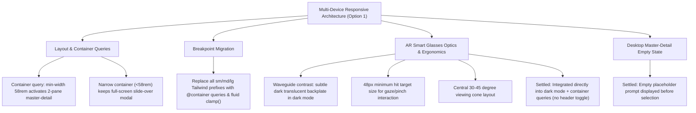

# Grill: Stress-Test Plan & Design Tree

## Design Tree & Settled Decisions

### Settled Decisions

1. **Option 1 Confirmed**: Unified Adaptive Container-Query Architecture.
2. **Q1 Settled (Desktop Empty State)**: On wide containers (>58rem), before an article is clicked, `#detail-panel` displays an Annuaire-styled empty placeholder card ("Select an article to read"). No article is prematurely marked as read.
3. **Q2 Settled (AR & Optical Waveguide Integration)**: Translucent high-contrast dark backplates (`rgba(18, 19, 22, 0.85)` with `backdrop-filter: blur(20px)`) and 48px hit areas are integrated directly into the responsive dark theme and container queries. No separate manual "AR toggle" button is added to the header, preserving Annuaire Rule 1 & 2 minimalism.
4. **Breakpoint Removal**: All hardcoded Tailwind viewport media query classes (`sm:`, `md:`, `lg:`) in `crates/ui-components/templates/partials/entry_list.html` are migrated to container queries (`@container`) and fluid CSS (`clamp()`, `repeat(auto-fit, minmax(...))`).
5. **Master-Detail JavaScript Sync**: `openEntryDetail(id)` updates the 3px positional red bar on the selected row in `#entries-list` and displays the article in `#detail-panel`. On mobile (<58rem), `#detail-panel` continues to function as an edge-to-edge slide-over with a prominent "Back" button.

## Frontier Evaluation

All questions on the frontier have been answered and accepted by the user.

## Result

Result: frontier-empty
